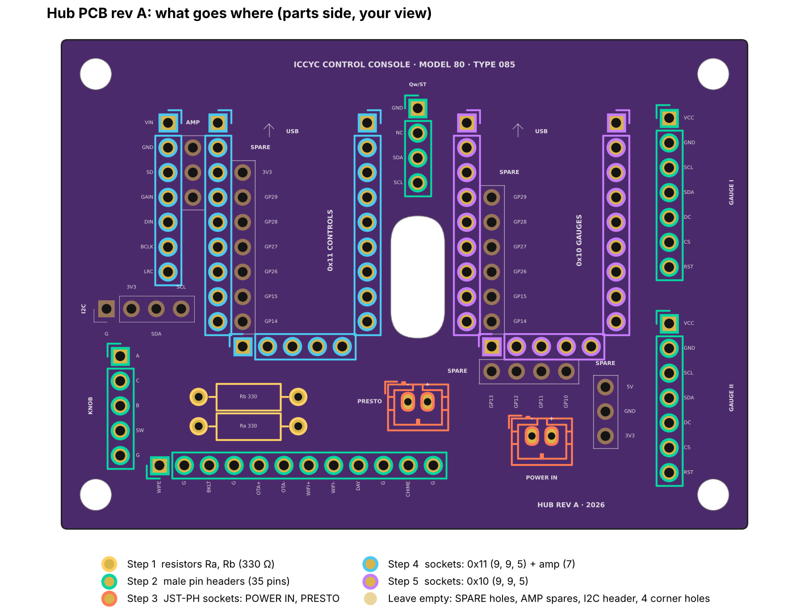
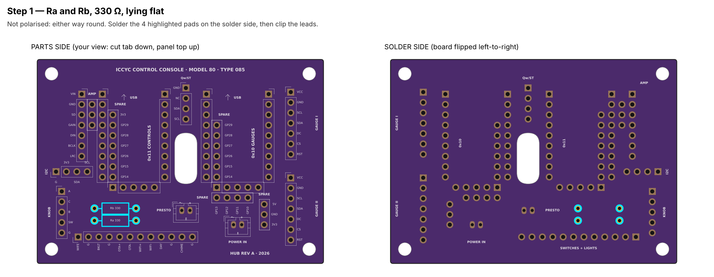
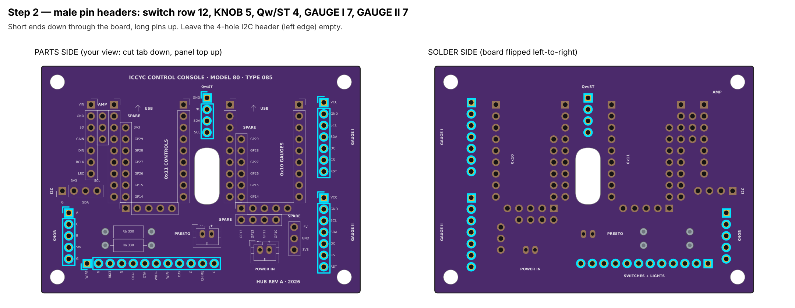
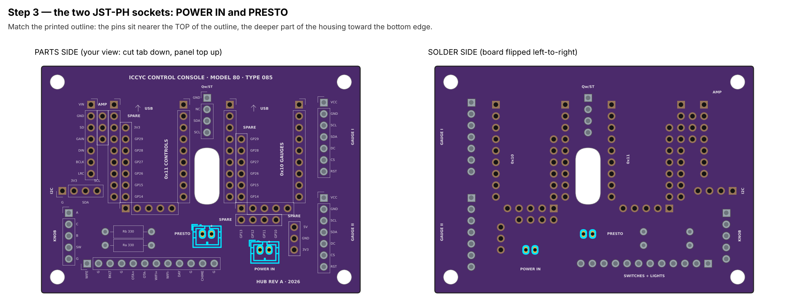
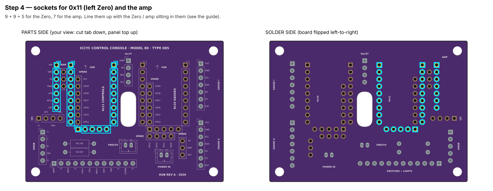
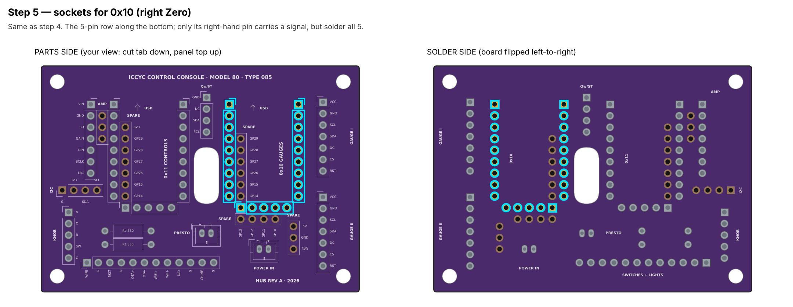
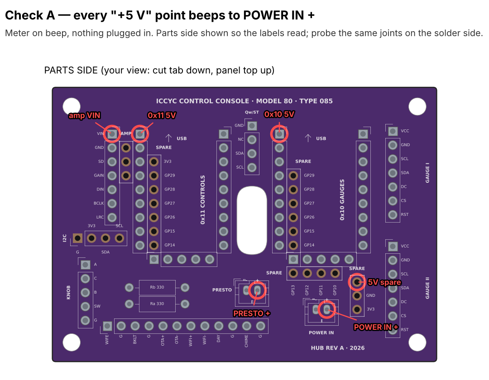
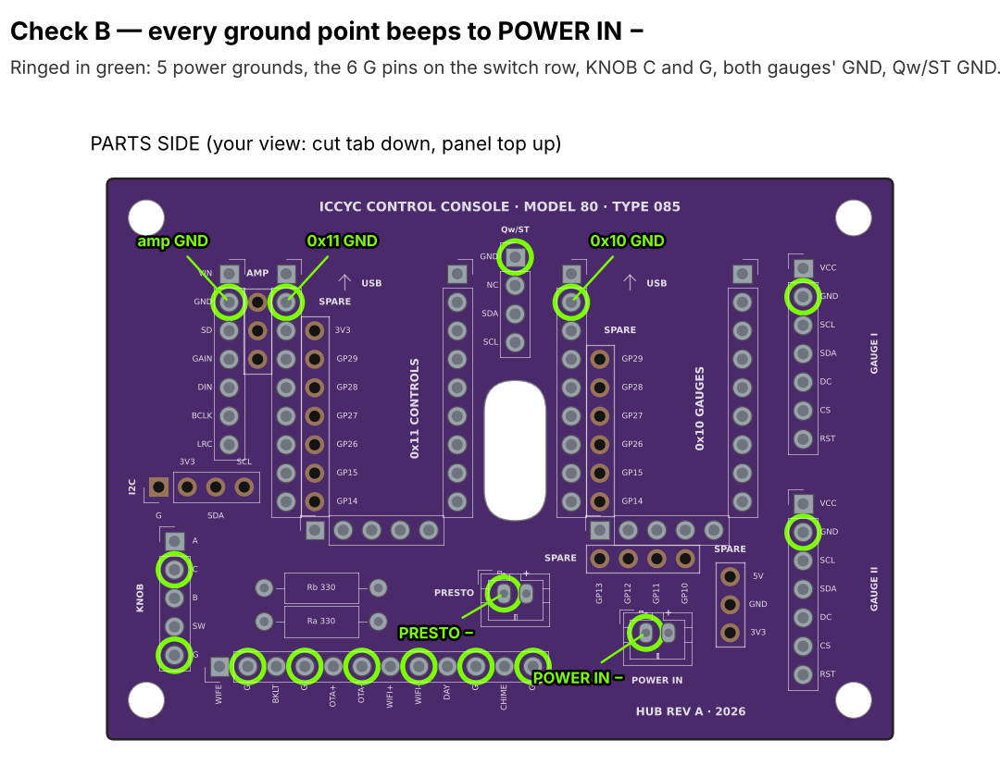
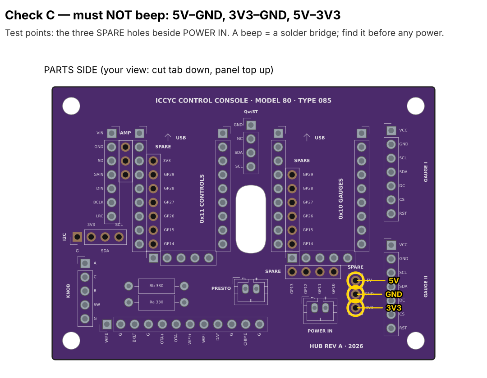

# ICCYC hub PCB rev A — soldering guide

**Status:** written before the first boards were built. The steps and pictures are drawn from the board file (`hub_pcb.kicad_pcb`) and checked against `hub_pcb.py`; `hub_pcb_steps.py` redraws the pictures.

> **⚠ Three corrections for rev A, found on the first board. Do all three from the start.** Details, picture and meter checks: **`hub-revA-rework.md`**.
>
> 1. **Leave out both 5-pin bottom sockets** (under 0x11 and under 0x10): the real Zero's bottom five pins sit one row higher than the board's bottom-row holes. Instead, solder **6 short wires** from the SPARE holes to the empty bottom-row holes and use the matching firmware (0x11 fw 0.4, 0x10 fw 1.3, in `coproc/`). That makes steps 4 and 5 "9 + 9" sockets per Zero, and about 86 joints plus 12 wire joints a board.
> 2. **Solder the PRESTO JST-PH socket turned round** (half a turn from its outline: the deeper part of the housing toward the **top** of the board). The Pololu PH–PH lead crosses over, so as printed the Presto would get reversed power. **POWER IN stays as printed.** With the turned socket the lead's black wire carries +5 V; that's expected.
> 3. **Sand the board's edge nubs flush first (step 0), and use hub shelf rev E2** (`hardware/enclosure/stl/p1_hub_shelf_revE2_print.stl`).
>
> The step pictures below still show the 5-pin sockets and the PRESTO socket the original way round. Go by this box where they differ.

This replaces the perfboard's solder order (`hub-board-build.md`, section 4) for the PCB. The circuit is the same; the board file is the source for what goes where.

**Orientation, everywhere in this guide (as in every project doc):** parts side facing you, the board as it sits on the hub shelf seen from the back of the panel — **"ICCYC CONTROL CONSOLE" along the top, "HUB REV A · 2026" bottom right.** When you flip the board to solder, left and right swap; the solder side has its own labels (0x11, 0x10, AMP, KNOB, GAUGE I / II, POWER IN, PRESTO, SWITCHES + LIGHTS) so you can tell which part's pins you're looking at.

**Pictures** are in the `hub-pcb-solder-guide\` folder next to this file. Each step picture shows both sides; the parts for that step are ringed in blue, parts already done are grey. The real board is purple with gold pads and white lettering, the same colours as the pictures.

---

## 1. A few words, if this is your first PCB

- **Pad:** the gold ring around each hole. The solder joins the part's leg to the pad.
- **Plated hole:** each hole is lined with copper right through the board, so the pad on top and the pad underneath are already joined. **You only solder on the solder side (underneath).** Solder often wicks up through the hole and shows on top; that's fine, nothing needs doing on the top side.
- **Traces:** the copper lines under the purple coating that join the pads. They're already done; that's the point of a PCB. Nothing to wire.
- **Silkscreen:** the white lettering. Every connector pin is named (WIFE, G, BKLT …), and a **square pad marks pin 1** of each part.
- **Ground fill:** most of both faces is one big sheet of ground copper under the purple. The ground pins of the headers (the **G** and **GND** pins) join that sheet through four thin spokes. The sheet soaks up heat, so **those pads take a second or two longer to heat up** than the others. If solder balls up and won't flow onto a G pad, hold the iron a little longer.
- **No parts are polarised except the two JST-PH sockets** (step 3) and the way the Zeros and amp face (step 4). Resistors, headers and the female sockets go in either way round.

## 2. How to make a joint (through-hole)

1. Iron hot, tip clean and shiny (wipe it, then melt a little solder on it). About **330–350 °C for leaded solder, 360–380 °C for lead-free.**
2. **Touch the tip to the pad and the leg at the same time**, for about a second, so both heat up.
3. **Feed the solder into the joint**, on the side opposite the tip, where the leg meets the pad — not onto the iron. A few millimetres is enough.
4. Take the solder away, then the iron. **Don't move the part for a second** while it sets. The whole thing takes 2–3 seconds.

**A good joint** is a shiny little cone that covers the whole pad, with the leg poking out of the top. **Redo it** if you see a ball sitting on the leg that doesn't wet the pad (not hot enough: reheat with a touch more solder), or **a bridge of solder between two pads** (heat it and drag the iron away from the gap, or use desoldering braid).

**Holding parts without fingers:** put the part in from the top, hold it down with a strip of **masking or painter's tape** (or a blob of Blu Tack), then flip the board. Rest the board on something (a helping-hands clamp, a PCB holder, or two stacks of books) so the part's own weight isn't pushing it out.

**Tack, look, then finish.** For anything with more than two legs: solder **one end pin only**, then look at the part from two sides. If it's tilted or lifted, reheat that one joint and press the part flat with a fingertip on the plastic (not the pin, which is hot). Then solder the other end pin, and then all the rest. This is the one habit that matters most for headers and sockets.

## 3. Have ready

- Iron, solder, a damp sponge or brass wool for the tip. Flux pen if you have one (helps on the ground pads; not essential with flux-core solder).
- **Flush cutters** (for resistor leads, and anything that sticks out too far underneath, section 6).
- Meter (beep / continuity mode and DC volts), calipers.
- Masking tape or Blu Tack.
- **Parts per board** (part numbers in `hub-pcb-parts-list.md`):

| Part | How many | Goes at |
|---|---|---|
| 330 Ω resistor | 2 | Ra, Rb (step 1) |
| Male pin strip (40) | 1 strip, broken into **12, 7, 7, 5, 4** (35 pins, 5 left over) | switch row 12, GAUGE I 7, GAUGE II 7, KNOB 5, Qw/ST 4 (step 2) |
| JST-PH 2-pin socket, upright | 2 | POWER IN, PRESTO (step 3) |
| Female socket, 9-pin | 4 | each Zero's left and right side (steps 4, 5) |
| ~~Female socket, 5-pin~~ | **0** | ~~each Zero's bottom edge~~: left out on rev A (box at the top); instead 6 insulated wires, about 1–3 cm each |
| Female socket, 7-pin | 1 | the amp (step 4) |

**Break the pin strip** with pliers at the notch between pins, or bend it over a table edge. Count pins, not millimetres.

**Leave empty:** the boxed **SPARE** holes, the three **AMP** spare holes (GND / SD / GAIN, for a louder-chime wire later), the 4-hole **I2C** header at the left edge, and the four big corner holes. They're for reusing the spare boards.

## 4. Suggested sittings

About 96 joints per board. Spread them out; nothing goes stale between sittings.

| Sitting | Steps | Joints |
|---|---|---|
| A | 0 (bare-board checks), 1 (resistors), 2 (pin headers) | 39 |
| B | 3 (JST-PH), 4 (0x11 + amp sockets) | 34 |
| C | 5 (0x10 sockets), 6 (underneath), 7 (meter checks) | 23 |

Build **one board all the way through section 8** before starting the other two. The first one is the template: anything that's awkward gets fixed in this guide before you repeat it.

---

## 5. The steps

### Step 0 — the bare board, before any solder

1. **Look it over** against the overview picture: the lettering, the cable slot between the Zeros, the four corner holes.
2. **Sand the edge nubs flush, then lay the bare board in the P1 rev E2 hub-shelf pocket** (box at the top; originally rev E1). It should sit flat on the ledge all round without being forced. If it doesn't fit, stop here: the fix is in the printed shelf (`hardware/enclosure/parts.scad`), not the board.
3. **Meter, beep mode:** touch the POWER IN pads' two holes (+ and −). **No beep.** Then the **5V** and **3V3** SPARE holes beside POWER IN: no beep. This catches a board fault before any parts hide it.

### Step 1 — Ra and Rb, 330 Ω (4 joints)

- Check the value first: meter on Ω should read about **330**. (Colour bands: orange-orange-brown on a 4-band resistor; orange-orange-black-black on a 5-band.)
- Bend both legs straight down, close to the body, so the legs are about **10 mm apart** (the holes are 10.16 mm apart). Either way round.
- **Rb** (OTA light) is the upper one, **Ra** (WiFi light) the lower one; they're printed on the board. They're identical, so a swap doesn't matter.
- Lay the resistor flat on the board, tape it, flip, solder, then **clip the legs** with flush cutters (flat side of the cutters toward the board; hold the loose end, they fly).

### Step 2 — male pin headers (35 joints)

- **Short ends go down through the board, long pins stick up** (that's what the jumper plugs push onto).
- Five headers: **switch row 12** along the bottom edge, **KNOB 5** at the left, **Qw/ST 4** at the top centre, **GAUGE I 7** and **GAUGE II 7** on the right edge.
- Tape one header in, flip, **tack one end pin**, check it stands straight up from two sides, fix if needed, tack the other end, then do the rest. One header at a time.
- Qw/ST: solder all four, including **NC** (the cable's red 3.3 V wire lands there and goes nowhere, by design).

### Step 3 — the two JST-PH sockets, POWER IN and PRESTO (4 joints)

**These are the only parts where turning them round is a real fault:** the plug only goes in one way, so a socket turned round would put +5 V on the ground wire.

- **Match the socket to its printed outline.** The two pins are not in the middle of the housing: in the outline they sit **nearer the top**, and the deeper part of the housing is toward the **bottom edge of the board**. Seat it so the housing fills the outline the same way. Turned round, it won't line up with the outline.
- Beside each socket the board shows **− on the left pin, + on the right** (pin 1 = ground, pin 2 = +5 V; the usual battery order).
- Tape, flip, solder both pins. These pins are thinner than the header pins, so use a little less solder.
- Section 8 checks the polarity with the real leads before anything gets power, so a mistake here gets caught there.

### Step 4 — sockets for 0x11 and the amp (30 joints)

Four sockets: **9 + 9 + 5** for the 0x11 Zero (left, under "0x11 CONTROLS"), **7** for the amp (column at the far left, beside VIN … LRC).

**Use a Zero as the jig.** Loose sockets drift and tilt, and a Zero that has to be forced in later strains the joints. Instead:

1. Put the three sockets in their holes.
2. **Plug a Zero into all three sockets at once**, pins down. It holds the sockets exactly where the Zero's pins are. It doesn't have to be the Zero that will live on this board.
   - **The Zero you use must have all 23 pins pointing down** out of its underside, the bottom five included.
   - **A Zero with no pins yet works too:** put loose male pin strips (9, 9, 5; long ends down) into the sockets and lay the Zero on the short ends. Solder the sockets to the hub first (sub-step 4 below), then solder the pins onto the Zero from its top side while it sits there. You get the Zero pinned and the sockets aligned in one go.
3. **Which way the Zero faces:** chip and USB-C socket **facing up** (away from the hub), **USB toward the top edge** (the printed "↑ USB" arrow). The Zero's **5V pin goes in the square pad** at the top of the left socket. A Zero that already has pins can only go in one way up; with loose pins it's easy to lay it upside down (chip facing the hub), and then every pin lands on the wrong signal, so check this before soldering.
4. Tape over the Zero, flip, and **tack one corner pin of each socket**. Flip back, check everything sits flat, then solder the rest.
5. **The amp, the same way:** plug the amp into its 7-pin socket as a jig. **VIN goes in the top hole (square pad, labelled VIN).** With VIN at the top, the amp's board must point **left, past the hub's edge** (toward the speaker), chip side up, its pin labels reading VIN, GND, SD, GAIN, DIN, BCLK, LRC from the top, the same as the hub's labels beside the socket (pin order confirmed on the real amp 2026-10-09). If its board points right, over the hub, it's upside down.
   - If the amp has no pins yet, use the loose-pins trick from 2 above. If its screw terminal isn't on yet, solder it on in the same sitting (2 joints).
6. Leave the Zero and amp in their sockets until you've done the next step if you like, but **take them out before the meter checks** (section 7).

### Step 5 — sockets for 0x10 (23 joints)

The same as step 4 for the right-hand Zero (under "0x10 GAUGES"): 9 + 9 + 5, Zero as the jig, chip up, USB toward the top edge, 5V in the square pad. On 0x10 only the bottom row's right-hand pin carries a signal (GP9, gauge II's reset), but **solder all five** — they hold the socket down.

---

## 6. Underneath: nothing taller than 2 mm

The board sits about 3 mm above the Presto's back, so **everything under the board must stay under 2 mm.** Aim for **1.5 mm or less**.

- The header and socket tails come out roughly **1.5 mm** below the board (from typical tail lengths on a 1.6 mm board — **not measured on these parts**). The JST-PH tails may come out a little further.
- **Measure** a few of each kind with the calipers' depth rod. **Clip anything over 1.5 mm** with flush cutters, then look at that joint again: it should still be a solid cone.
- The resistor legs were clipped in step 1; check them too.

## 7. Meter checks, before any power

**Nothing plugged in:** no Zeros, no amp, no leads. Meter in beep mode. Probe the joints on the solder side (the pictures show the parts side so the labels read; the solder side has the same joints, mirrored).

**Check A — +5 V reaches everything that needs it.** Hold one probe on POWER IN **+**; each of these must beep: PRESTO **+**, the 0x11 socket's 5V (square pad), the 0x10 socket's 5V (square pad), the amp's **VIN**, the 5V spare hole.

**Also:** the 0x10 socket's **third pin from the top** (its 3V3) must beep to **VCC** on both GAUGE headers and to the 3V3 spare hole. (The gauges run from 0x10's 3.3 V.)

**Check B — ground reaches everything.** Hold one probe on POWER IN **−**; each of these must beep: PRESTO **−**, the **second pin from the top** of the 0x11, 0x10 and amp sockets (their GND), the six **G** pins on the switch row (G, G, OTA−, WIFI−, G, G), KNOB **C** and **G**, both gauges' **GND**, Qw/ST **GND**.

**Check C — no shorts. These must NOT beep:** 5V to GND, 3V3 to GND, 5V to 3V3. The three SPARE holes beside POWER IN (5V, GND, 3V3) are handy test points.

There are no capacitors on the hub, so with nothing plugged in **any** beep in check C is a real short: almost always a solder bridge between two neighbouring pads. Find it with a bright light (or your phone's camera zoomed in) before going further. (With the Zeros plugged in, 5V–GND can beep for a moment while their capacitors charge — that's why this check is done with the board bare.)

Neighbouring pins on the headers are worth a look too: a quick scan along each row for solder joining two pads.

## 8. Polarity with the real leads, then 5 V on the bare board

This is the check from `hub-pcb-parts-list.md` section 2, now that there's a board to do it on.

1. **Presto lead, unpowered:** plug the Pololu PH–PH lead into the hub's **PRESTO** socket and into the **Presto's battery socket**. Beep from the hub's **5V spare hole** to the Presto's **+** mark by its battery socket: **must beep.** Hub GND spare to the Presto's **−**: must beep. Then unplug it from the Presto again.
2. **xiwai lead:** plug it into **POWER IN**. Its **red wire should go into the + side** of the socket (look at the plug).
3. **5 V on the bare board** — hub only, **no Zeros, no amp, no Presto lead**: plug a USB-C charger into the xiwai USB-C socket (in the back plate or loose on the bench). Meter on **DC volts**, red probe on the **5V** spare hole, black on **GND**: expect **about +5.0 to +5.2 V**. **A minus sign means the polarity is backwards: unplug and stop.** The 3V3 hole reads 0 (no Zero in yet). Unplug.

Only after all of this do the Zeros, the amp and the leads go in — that's assembly, not this guide. **The usual rule still holds: unplug the case's power before plugging a USB cable into a Zero or the Presto.**

## 9. Not yet confirmed (VERIFY)

- The tail lengths in section 6 are estimates; measure on the first board.
- The JST-PH socket's way round is read from KiCad's standard footprint for this part; the meter check in section 8 is the real test.
