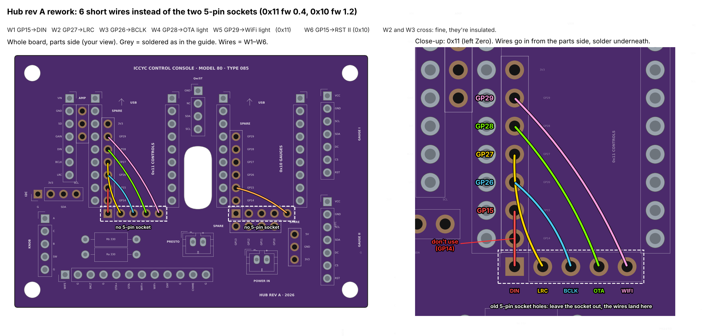

# Hub PCB rev A — known faults and the fixes

Rev A works, but it needs these corrections. All of them were found on the
first board and tested on it; the first console built with them runs every
feature (knob, switches, pilot lights, chime, both gauges). Do them from the
start on any rev A board. The soldering guide (`hub-pcb-solder-guide.md`) has
the same list in a box at its top.

## 1. The Zero's bottom row: leave the 5-pin sockets out, add 6 wires

On the real RP2040-Zero, **GP14, GP13 … GP9 and GP8 sit in one straight row**
along the bottom edge. The board puts each Zero's 5-pin bottom socket **one row
(2.54 mm) lower** than that, so the bottom five pins can't plug in. (The side
rows are right: a Zero seats in the two 9-pin sockets.) The layout was carried
over from a perfboard note that was never checked against the Zero's drawing;
KiCad's checks can't catch a mistake like this.

Only the bottom row is affected:
- **0x11:** GP9 WiFi light, GP10 OTA light, GP11 BCLK, GP12 LRC, GP13 DIN.
- **0x10:** GP9 = gauge II's reset (GP10–GP13 unused).

**The fix:** leave both 5-pin sockets out. The side pins the boards don't use
already come out to the **SPARE** holes beside each Zero. A short wire from a
spare hole to the empty old bottom-row hole joins the new pin to the original
trace, and the firmware uses the new pins.

| Wire | From (spare hole) | To (old bottom-row hole) | Signal |
|---|---|---|---|
| W1 | 0x11 SPARE **GP15** | 0x11 bottom hole 1 (square pad, left) | amp DIN |
| W2 | 0x11 SPARE **GP27** | 0x11 bottom hole 2 | amp LRC |
| W3 | 0x11 SPARE **GP26** | 0x11 bottom hole 3 | amp BCLK |
| W4 | 0x11 SPARE **GP28** | 0x11 bottom hole 4 | OTA light (Rb) |
| W5 | 0x11 SPARE **GP29** | 0x11 bottom hole 5 (right) | WiFi light (Ra) |
| W6 | 0x10 SPARE **GP15** | 0x10 bottom hole 5 (right) | gauge II reset |

- **Don't use the GP14 spare holes** (bottom of each SPARE column): a Zero's
  bottom-left pin sits right above them.
- W2 and W3 cross. They're insulated, so that's fine (the RP2040's sound output
  needs LRC on the pin after BCLK, which forces one crossing).
- **Wire:** insulated, ideally thin solid-core (22–26 AWG). Cut each one about
  10 mm longer than its path, strip 3–4 mm at both ends, put both ends in from
  the **parts side**, lay the wire flat, tape it, flip, solder underneath, clip
  the tails under 1.5 mm. 12 joints in all.
- **Clearance:** the wires lie under the Zero, which sits about 11 mm up on its
  sockets. A Zero whose bottom five pins point **down** has their tips about
  2.5 mm above the board, right over the wires: keep the wires flat, or clip
  those five pins short (they aren't used).

**Meter checks (beep mode, nothing plugged in):**
- Each wire's two holes: beep.
- Through the board's own traces, each must beep: W1's spare hole to the amp
  socket's **DIN**; W2 to the amp's **LRC**; W3 to the amp's **BCLK**; W4 to
  **Rb's left lead** (upper resistor); W5 to **Ra's left lead** (lower
  resistor); W6 to **GAUGE II's RST** pin.
- W2 and W3 spare holes to each other: **no beep**.
- Then the soldering guide's checks A–C and section 8 as written.

**Firmware:** `coproc/controls/main.py` (0x11) is **fw 0.4** — pilot lights
GP29 (WiFi) / GP28 (OTA), amp BCLK GP26, LRC GP27, DIN GP15.
`coproc/gauges/main.py` (0x10) is **fw 1.3** — gauge II's reset on GP15 (fw
1.2), and both pictures turned half a turn for the panel mount (fw 1.3, see
`hardware/wiring/wiring-plan.md`). The Presto's Diagnostics page shows each
board's fw. Boards wired by hand to the old pins (GP9–GP13) need fw 0.3 / 1.1.

## 2. The PRESTO socket goes in turned round

The Pololu #5604 JST-PH lead (the Presto lead in the parts list) **crosses over**
between its two plugs. With the **PRESTO** socket soldered as printed, the hub's
+5 V reaches the Presto's **−**. Fix: solder the PRESTO socket rotated half a
turn from its outline (the deeper part of the housing toward the **top** of the
board, toward the cable slot). Turned round, the housing still clears
everything. **POWER IN stays as printed.**

With the turned socket the lead's **black wire carries +5 V** and red is
ground. That's expected. Whatever lead you use, do the soldering guide's
section 8 beep check (hub 5V spare hole → the Presto's **+**, marked above its
battery socket) before any power.

## 3. Sand the edge nubs flush; use hub shelf rev E2

OSH Park's break-off nubs made the first board measure about **71.6 × 51.6 mm**
instead of 70 × 50, and it caught in the rev E1 shelf pocket. Sand the edges
flat on ~220 grit paper laid on the table (damp, or with a mask: fibreglass
dust) until it measures about 70 × 50; the copper stays 0.5 mm in from the
edge, so stop once the nubs are gone. Print the shelf as
`hardware/enclosure/stl/p1_hub_shelf_revE2_print.stl` (0.5 mm a side plus a
round relief at each corner; `hub_pocket_clear` and `hub_corner_relief_r` in
`parts.scad`).
